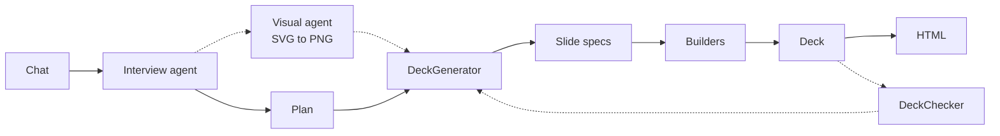

# Slide Decks

[](https://github.com/phv2312/fixed-deck-generator/actions/workflows/pre-commit.yml)
[](https://github.com/phv2312/fixed-deck-generator/actions/workflows/pytest.yml)


Slide Decks makes a slide deck from a chat. An LLM interview agent asks questions and writes a
plan. A deck generator fills one fixed template for each slide. A deterministic engine places
every element and renders one self-contained HTML file.



## Why this project exists

Most LLM slide generators let the model invent the slide. The model picks the elements, their
sizes, and their positions. Each run gives a different result. The same content can look
different each time. The slides often break slide conventions: titles move, spacing changes, and
elements overlap or do not align. The user cannot trust the output, and the deck does not look
like one deck.

This project removes that freedom. It defines a fixed set of slide **families** and **kinds**:

- A **family** is a group of slides for one purpose. Examples are `analytics`, `body`, `diagram`,
  and `layout`.
- A **kind** is one exact slide template in a family. A kind has a fixed structure and a fixed
  list of parameters. A deterministic builder owns its layout.

The LLM only does two things. It chooses a kind that fits the content. Then it fills the
parameters of that kind. It does not draw or position anything. Thus a slide follows the same
conventions each time, and a deck looks consistent from the first slide to the last.

See the [slide catalog](docs/slide-catalog/README.md) for every family and kind.

## Quick start

```bash
uv sync
cp .env.example .env   # fill in the Azure OpenAI values
uv run python -m decks review -o gallery.html
open gallery.html
```

Use `uv run python -m scripts.chat` to start a chat and make a deck.

## Documentation

| Document | Content |
|---|---|
| [docs/architecture/](docs/architecture/README.md) | How the system is built. |
| [docs/builder-authoring.md](docs/builder-authoring.md) | How to add or change a slide kind. |
| [docs/slide-catalog/](docs/slide-catalog/README.md) | Every slide kind, with parameters and previews. |
| [docs/rules/](docs/rules/) | Coding, testing, documentation, and commit rules. |
| [AGENTS.md](AGENTS.md) | Entry point for humans and AI agents. |

## Contributing

1. Read [AGENTS.md](AGENTS.md) and the rule file for your task in [docs/rules/](docs/rules/).
2. Make your change. Add or update tests. Mirror the source layout in `tests/`.
3. Update the matching document in `docs/`. Run `uv run python -m scripts.gen_catalog` if you
   change a slide kind. Do not edit `docs/slide-catalog/` by hand.
4. Run all checks. All of them must pass. GitHub Actions runs the same checks (`pre-commit` and
   `pytest`) on every push to `main` and every pull request to `main`:

   ```bash
   uv run ruff check
   uv run ruff format --check
   uv run ty check
   uv run pytest
   ```

5. Commit with a Conventional Commits subject and a GPG signature. See
   [docs/rules/git-commit.md](docs/rules/git-commit.md).
