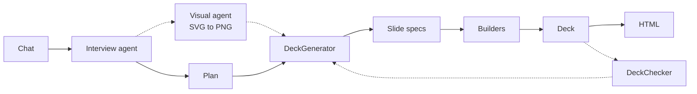

# Slide Decks

[](https://github.com/phv2312/fixed-deck-generator/actions/workflows/pre-commit.yml)
[](https://github.com/phv2312/fixed-deck-generator/actions/workflows/pytest.yml)

Slide Decks makes a slide deck from a chat. An LLM interview agent asks questions and writes a
plan. A deck generator fills one fixed template for each slide. A deterministic engine places
every element and renders one self-contained HTML file.

The LLM fills parameters. It does not draw or position anything. Thus a slide looks the same
each time.

## Quick start

```bash
uv sync
cp .env.example .env   # fill in the Azure OpenAI values
uv run python -m decks review -o gallery.html
open gallery.html
```

Use `uv run python -m scripts.chat` to start a chat and make a deck.

## Architecture



- **Agent layer** (`decks/agents/`, `decks/visuals/`): chat, plan, and deck generation.
- **Deck engine** (`decks/models/`, `decks/builders/`, `decks/render/`): spec to positioned
  elements to HTML. It uses no LLM.

## Documentation

| Document | Content |
|---|---|
| [docs/architecture/](docs/architecture/README.md) | How the system is built. |
| [docs/builder-authoring.md](docs/builder-authoring.md) | How to add or change a slide kind. |
| [docs/slide-catalog/](docs/slide-catalog/README.md) | Every slide kind, with parameters and previews. |
| [docs/rules/](docs/rules/) | Coding, testing, documentation, and commit rules. |
| [AGENTS.md](AGENTS.md) | Entry point for humans and AI agents. |

## Contributing

1. Read [AGENTS.md](AGENTS.md) and the rule file for your task in [docs/rules/](docs/rules/).
2. Make your change. Add or update tests. Mirror the source layout in `tests/`.
3. Update the matching document in `docs/`. Run `uv run python -m scripts.gen_catalog` if you
   change a slide kind. Do not edit `docs/slide-catalog/` by hand.
4. Run all checks. All of them must pass. GitHub Actions runs the same checks (`pre-commit` and
   `pytest`) on every push to `main` and every pull request to `main`:

   ```bash
   uv run ruff check
   uv run ruff format --check
   uv run ty check
   uv run pytest
   ```

5. Commit with a Conventional Commits subject and a GPG signature. See
   [docs/rules/git-commit.md](docs/rules/git-commit.md).
