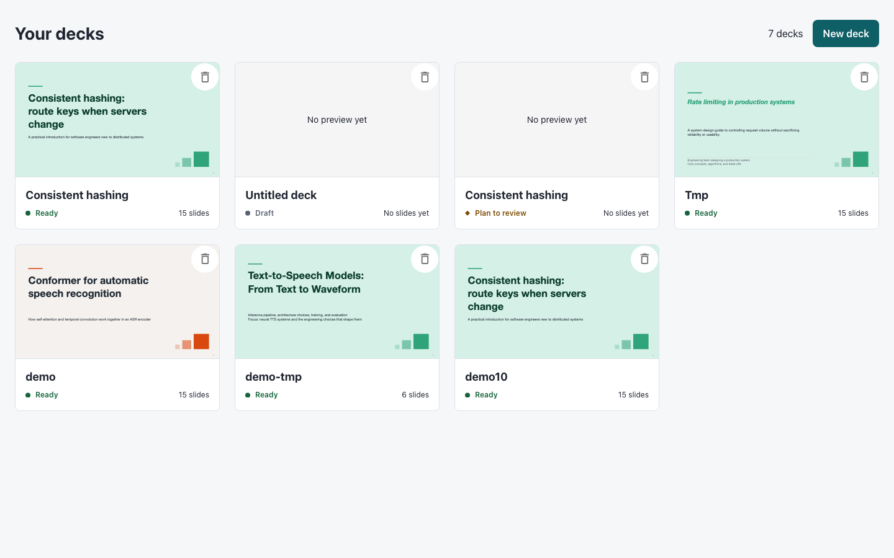
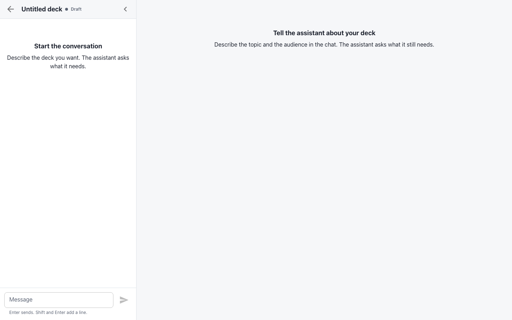

# Scenario 1: create a project

Goal: make an empty deck and see that the app opens it.

## Steps

1. Open `http://localhost:5173`. The page shows **Your decks**.

2. Select **New deck**. You do not type a name.
3. Wait for the project page. The address changes to `/projects/<id>`.

## Check

- The project page opens at once. No dialog asks for a name.
- The chat column shows **All decks** as an arrow, the name **Untitled deck**, and the state **Draft**.
- The chat shows **Start the conversation**.
- The right side shows **Tell the assistant about your deck**.
- Select the arrow in the chat column. The start page shows the new deck in the list. It has no slides yet.

## If it fails

- The button stays on **Creating deck**: the API is not running. Do the quick check in the [README](./README.md).
- A red message shows under the title: read it. It comes from the API.

## Notes

The deck keeps the name **Untitled deck** until its plan has a first slide. Then the deck takes the title of that slide. See scenario 2.
