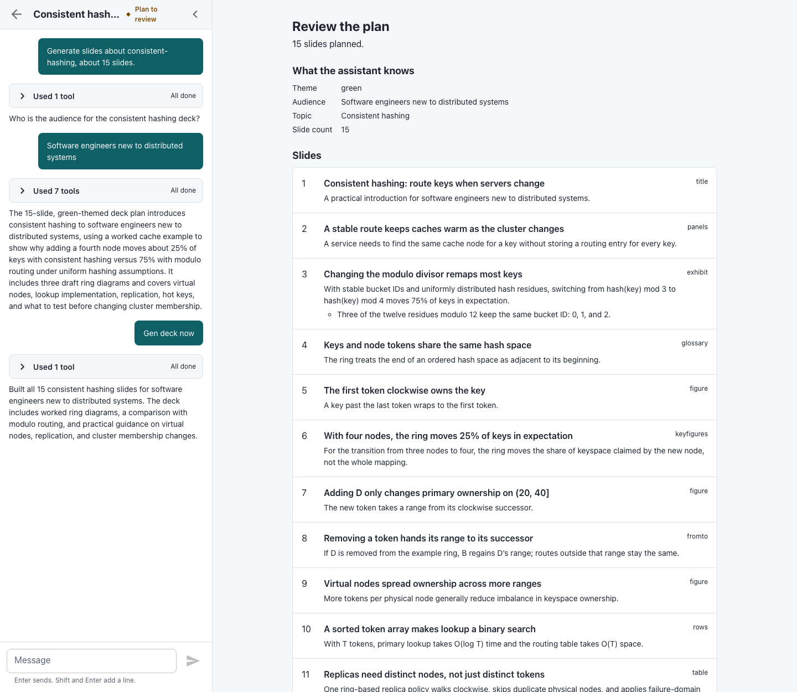
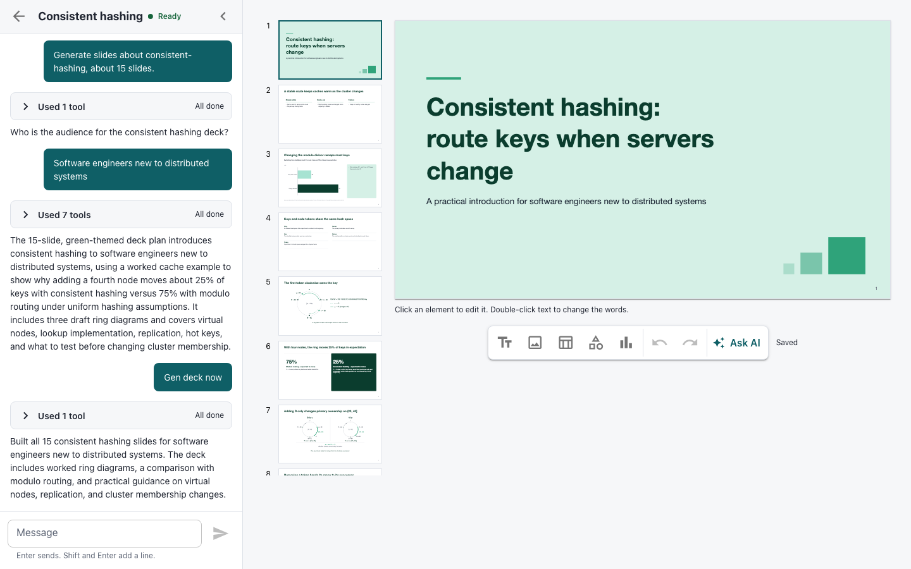

# Scenario 2: make a deck in the chat

Goal: go from an idea to a built deck. The topic in this scenario is consistent hashing.

This scenario needs the Azure OpenAI values in `.env`. It takes a few minutes. Most of the time goes to the assistant.

## Steps

1. Do [scenario 1](./01-create-project.md). Stay on the project page.
2. In the chat, send this message:

   ```text
   I want a short deck about consistent hashing. The audience is software engineers who know basic distributed systems.
   ```

3. The assistant asks questions. Each question shows on the right with choices. Select a choice, or select **Something else** and type your answer. Then select **Send answer**. Answer every question. Short answers are fine. For the theme, pick any one.
4. Wait while the right side shows **The assistant is working**. The state shows **Plan to review** when the plan is ready.
5. Read the plan under **Review the plan**. Check the slide titles. To change something, select **Request changes**, write what should change, and select **Send changes**. Then read the plan again.


6. Select **Approve plan**. The state changes to **Plan approved**, then **Generating**. The right side shows the slide count.
7. Wait until the state shows **Ready**. The slide editor opens.



The pictures show a finished deck about consistent hashing. Your plan and slides are different, because the assistant writes them again each time.

## Check

- Each answer you send shows in the chat, and the assistant continues.
- The plan lists the slides. The summary says how many slides are planned.
- The deck name in the chat column is now the title of the first slide of the plan. It is no longer **Untitled deck**.
- When the build ends, the editor shows a list of slides on the left and the first slide in large size.
- The thumbnails and the large slide show the same slide. Their top edges are on the same line.
- Select **All decks**. The deck is on the start page with its first slide as a picture and the state **Ready**.

## If it fails

- The chat shows **The last message failed**: send the message again.
- Nothing happens for more than a few minutes: check the terminal of the API for an error. Check the Azure values in `.env`.
- The state stays on **Generating**: reload the page. The state and the chat come from the server.
