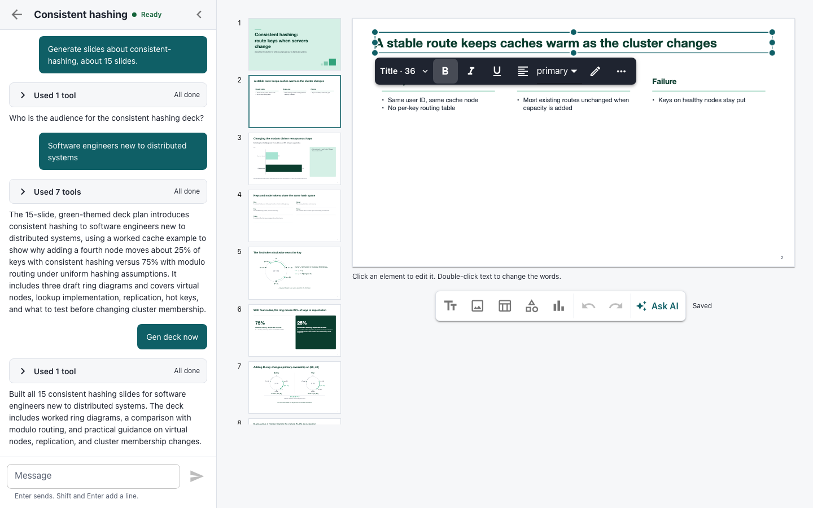
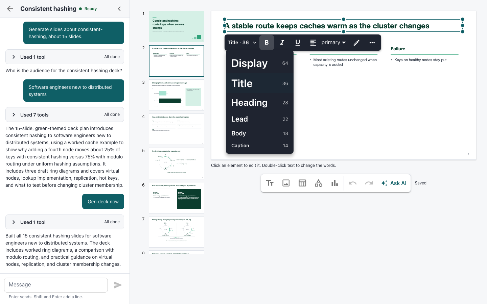
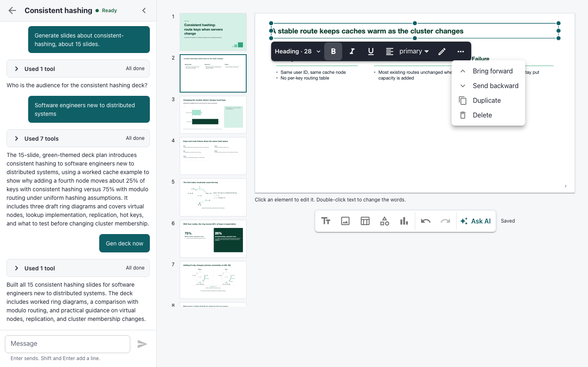
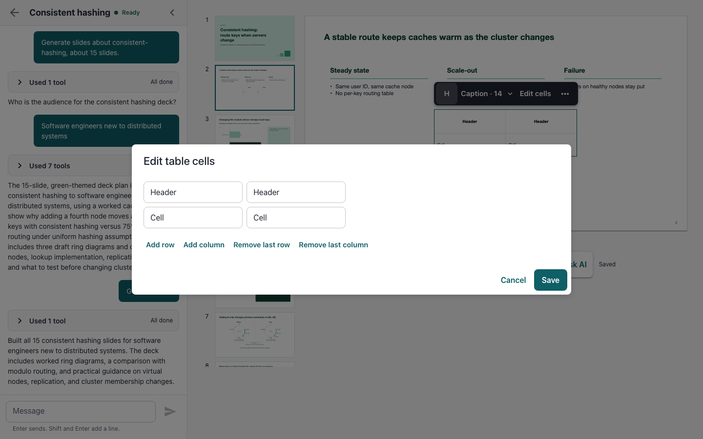

# Scenario 3: edit elements

Goal: change a slide with the editor. Each edit must show on the slide at once, without a reload.

You need a deck with the state **Ready**. Use the deck of [scenario 2](./02-chat-to-deck.md). Do the edits on a copy if the deck is important.

## Parts of the editor

- **Slide list** on the left. Select a thumbnail to open that slide.
- **Slide** in the middle. Each element has an invisible box. A box shows its outline when you point at it.
- **Element toolbar.** A short dark bar floats over the selected element. For text it has the text size, bold, italic, underline, align, color, a pencil, and a **More** menu (**⋯**).
- **Bottom bar.** Icons to add text, an image, a table, a shape, or a chart. Then undo, redo, and **Ask AI**. **Saved** shows next to it.

## Steps

1. Open slide 2. Select the title. A frame with handles shows, and the toolbar floats over it.
2. Select the text size button. A list opens with **Display** (64), **Title** (36), **Heading** (28), **Lead** (22), **Body** (18), and **Caption** (14). The size that the element has now is marked. A size that is not in the list shows as **Custom**. Select **Heading**.

   

3. Select **B** (bold), then **I** (italic), then **U** (underline). Select each one again to turn it off.
4. Select the align button. The text moves left, to the center, or right, one step for each press.
5. Select the color list. Choose another color.
6. Select the pencil, or double-click the title. Change the words. Select outside the text to save.
7. Drag the title to a new place. Drag a corner handle to change its size.
8. Select another text on the slide. The toolbar must move to that text.
9. Select an element and press an arrow key. The element moves a small step.
10. Select **⋯** to see the less used actions. Then select **Send backward**, then **Bring forward**, then **Duplicate**.

    

    Select the copy and select **⋯**, then **Delete**.
11. In the bottom bar, select the shape icon, then the text icon. Each adds an element to the slide.
12. Select the table icon in the bottom bar.

    

    Then select the new table, select **Edit cells**, type in a cell, add a row, and select **Save**.

    

13. Select the image icon. Paste an address that starts with `https://` and select **Save**.
14. Select **Undo** until the slide is as it was. Then select **Redo** once. Press `Ctrl+Z` (`Cmd+Z` on a Mac) once.

## Check

- Every change in steps 2 to 13 shows on the large slide and on its thumbnail within a second or two. You never reload the page.
- The toolbar always sits over the element that you selected last.
- After a drag, the handles are on the element. No old frame stays behind.
- Delete removes the element. Duplicate adds one.
- Undo and redo move the slide back and forward through your edits. A button is gray when it has nothing to do.
- The bottom bar shows **Saved** after each edit.
- Reload the page. Your edits are still there.

## If it fails

- A change does not show: reload once. If it still does not show, check the terminal of the API.
- The bottom bar shows a message about a deck that changed: the deck changed somewhere else. The app reloaded it. Do the edit again.
- The editor shows **The assistant is working on this deck**: wait. The editor is locked while the assistant works.

## Known limits

- A chart shows as a dashed box with its kind. The app does not draw charts in the slide yet.
- Slides that the assistant built are made of many small elements. A table in such a slide is not one table element. You select its cells one by one.
