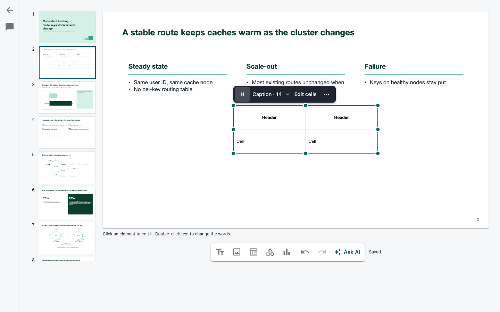
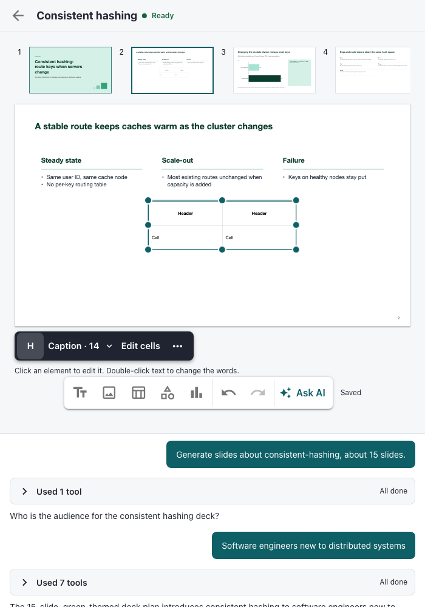

# Scenario 4: work with the layout

Goal: fold the chat, move between pages, and see that the deck name follows the plan.

You need a built deck. Use the deck of [scenario 2](./02-chat-to-deck.md).

## Steps

1. Open the deck. The chat is a column on the left. At the top of the column, one row shows an arrow, the deck name, the state, and a fold button.
2. Point at the arrow. The tip says **All decks**.
3. Select the fold button (the small arrow that points left). The chat folds into a narrow rail. The slides get the room.
   

4. In the rail, select the chat icon. The chat opens again.
5. Fold the chat again. In the bottom bar, select **Ask AI**. The chat opens.
6. Select the arrow. The start page opens.
7. Select the deck in the list. The project page opens again.
8. Make the browser window narrow, less than 1024 pixels. The deck name and the state move to a row above the slides. The chat goes below the slides.

## Check

- The page has no top bar with a title. The start page shows **Your decks** at the top.
- The row in the chat column is one line. A long deck name ends with `…`. Point at the name to see all of it.
- Folding and opening the chat does not lose messages.
- The slides and their frames stay lined up after you fold or open the chat. Select an element before and after: the frame is on the element.
- The rail has two icons: the way back and the chat.

## If it fails

- The frame of a selected element is not on the element after you fold the chat: select another slide and select the element again. Tell the team, because this is a bug.
