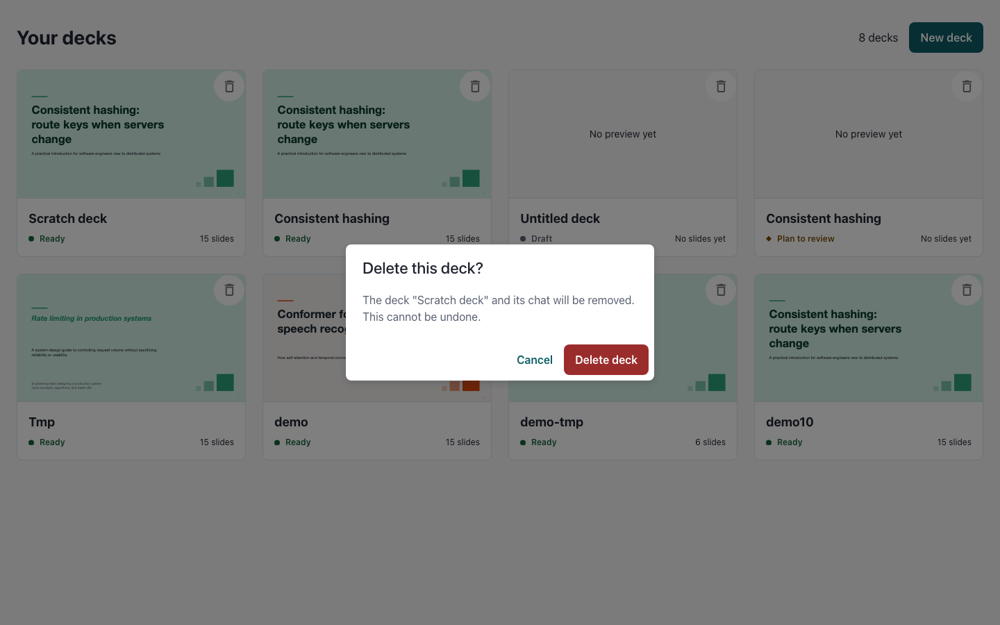

# Scenario 5: delete a deck

Goal: remove a deck and see that it is gone. Do this on a deck that you do not need, for example the empty deck of [scenario 1](./01-create-project.md).

## Steps

1. Open the start page. Each deck is a card.
2. Select the trash icon on the card of the deck to remove. A dialog asks **Delete this deck?**. It names the deck.
   

3. Select **Cancel**. The deck stays in the list.
4. Select the trash icon again. Select **Delete deck**.
5. Open the old address of the deck, `/projects/<id>`.

## Check

- After **Delete deck**, the card is gone and the count is one less.
- The old address shows that the project does not exist, with a way back to **All decks**.
- A deck in the middle of a chat turn cannot be deleted. The dialog shows that the assistant is still working. Try again when it is done.
