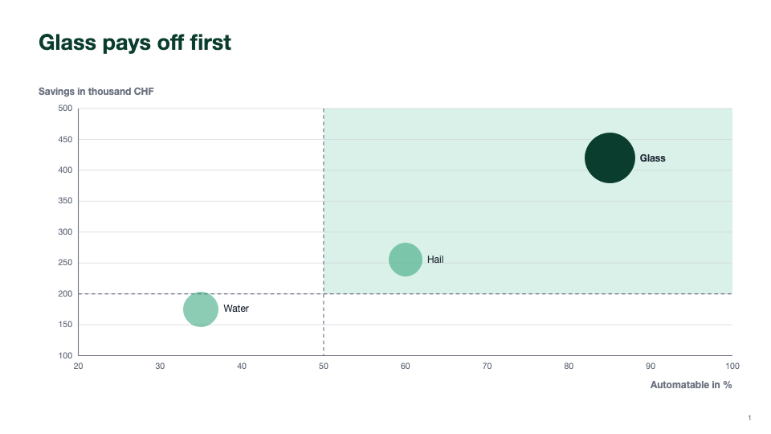
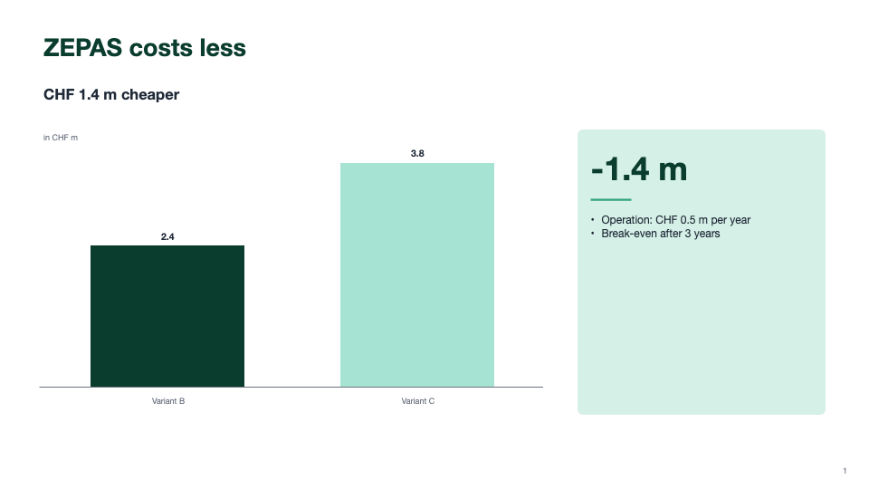
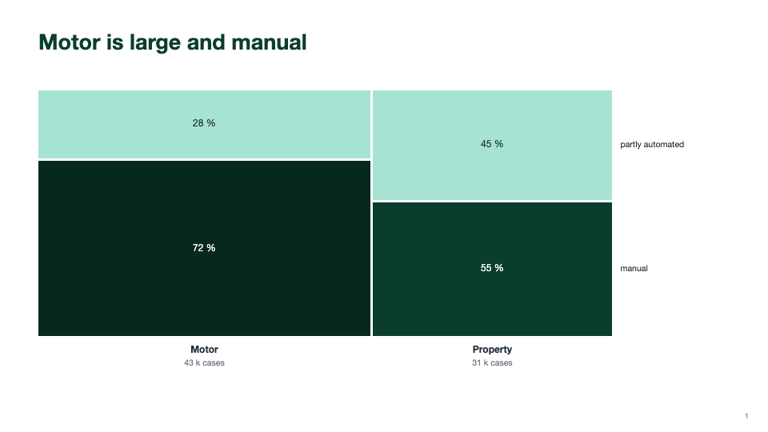
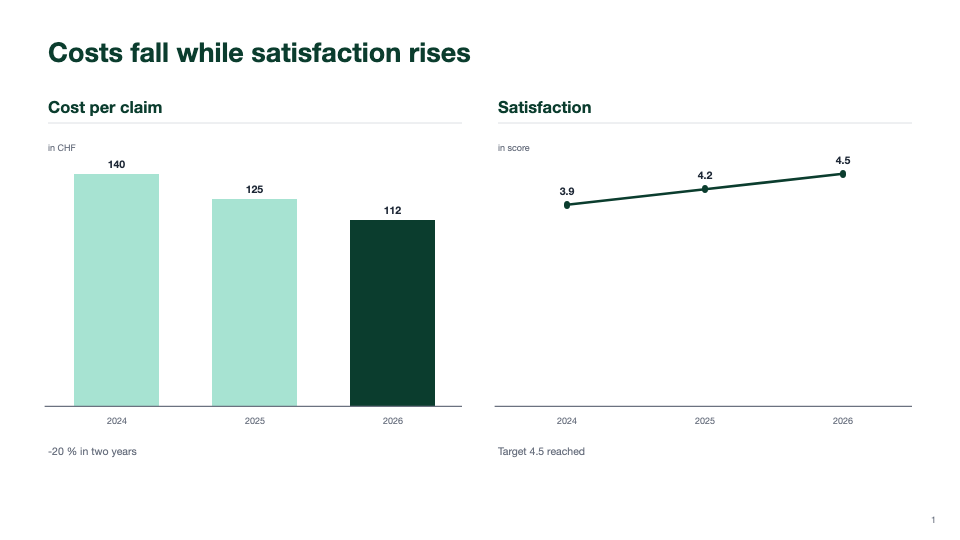

# analytics

[← All families](README.md)

Charts and data-driven slides.

| slide | preview & description | parameters |
|---|---|---|
| `bubble` |  Use this slide to position items on two numeric axes. Bubble size adds a third measure. You can also split the chart into quadrants. | `title` (str, required): Slide headline. `items` (list[BubbleItem], required): Bubbles to plot. `items[].name` (str, required): Label shown next to the bubble. `items[].x` (float, required): Horizontal value of the bubble. `items[].y` (float, required): Vertical value of the bubble. `items[].size` (float, required): Size weight of the bubble. Larger values draw larger bubbles. `x_axis` (Axis | str, required): Horizontal axis: structured Axis settings, or a plain axis label string. `y_axis` (Axis | str, required): Vertical axis: structured Axis settings, or a plain axis label string. `split` (tuple[float, float] | None, optional): Optional (x, y) split values for the dashed quadrant lines. The slide shades the top-right quadrant. `size_label` (str | float | None, optional): Label for the bubble-size legend, e.g. a unit or scale note. `highlight` (int | None, optional): 0-based index into items drawn in the primary color. |
| `exhibit` |  Use this slide for a chart-led slide. It supports column, stacked, bar, hstacked, bar100, line, doughnut and waterfall charts. You can also add a takeaway, a hero figure, a so-what list and a source note. | `title` (str, required): Slide headline. `chart` (Chart, required): Chart configuration for the exhibit. `chart.type` (Literal["column", "bar", "stacked", "hstacked", "bar100", "line", "doughnut", "waterfall"], required): Chart type to render. `chart.categories` (list[str], required): Category labels along the value axis. `chart.series` (dict[str, list[float]] | list[float], required): A mapping of series name to values, or one unnamed list of values, one per category. `chart.unit` (str | None, optional): Unit suffix shown with the values, e.g. 'k€'. `chart.labels` (bool, optional, default: true): If true, the chart prints value labels. `chart.highlight` (int | None, optional): 0-based category index to emphasise. `chart.centre` (str | None, optional): Centre text for doughnut charts. `chart.totals` (list[int] | None, optional): Waterfall only: indices of the total bars. A value of 0 uses the running sum. Any other value sets the total to that value. `takeaway` (str | None, optional): Takeaway text. Omit takeaway, so_what and figure to get a bare full-width chart. `so_what` (list[str], optional, default: []): Optional 'so what' bullets shown beside the chart. `figure` (str | None, optional): Optional figure label for the exhibit. `source` (str | None, optional): Source line shown at the bottom of the slide. `note` (str | None, optional): Additional footnote text. |
| `mekko` |  Use this slide to show market share or composition. In this slide, the column width and the stacked parts both have a meaning. | `title` (str, required): Slide headline. `columns` (list[MekkoColumn], required): Columns, each with a width weight and one value per part. `columns[].name` (str, required): Column label. `columns[].size` (float, required): Width weight of the column. The slide normalises the widths across all columns. `columns[].values` (list[float], required): Segment values, one per entry in parts. The slide normalises them to 100%. `parts` (list[str], required): Segment labels, stacked top to bottom. `highlight` (tuple[int, int] | None, optional): (column index, part index) pair to emphasise. `unit` (str | float | None, optional): Unit of the column size values. |
| `twocharts` |  Use this slide to place two charts side by side for comparison. Each chart has a heading and an optional note. | `title` (str, required): Slide headline. `left` (ChartSide, required): Left-hand chart panel. `left.head` (str, required): Side heading. `left.chart` (Chart, required): Chart for this side. `left.chart.type` (Literal["column", "bar", "stacked", "hstacked", "bar100", "line", "doughnut", "waterfall"], required): Chart type to render. `left.chart.categories` (list[str], required): Category labels along the value axis. `left.chart.series` (dict[str, list[float]] | list[float], required): A mapping of series name to values, or one unnamed list of values, one per category. `left.chart.unit` (str | None, optional): Unit suffix shown with the values, e.g. 'k€'. `left.chart.labels` (bool, optional, default: true): If true, the chart prints value labels. `left.chart.highlight` (int | None, optional): 0-based category index to emphasise. `left.chart.centre` (str | None, optional): Centre text for doughnut charts. `left.chart.totals` (list[int] | None, optional): Waterfall only: indices of the total bars. A value of 0 uses the running sum. Any other value sets the total to that value. `left.note` (str | None, optional): Optional note under the chart. `right` (ChartSide, required): Right-hand chart panel. `right.head` (str, required): Side heading. `right.chart` (Chart, required): Chart for this side. `right.chart.type` (Literal["column", "bar", "stacked", "hstacked", "bar100", "line", "doughnut", "waterfall"], required): Chart type to render. `right.chart.categories` (list[str], required): Category labels along the value axis. `right.chart.series` (dict[str, list[float]] | list[float], required): A mapping of series name to values, or one unnamed list of values, one per category. `right.chart.unit` (str | None, optional): Unit suffix shown with the values, e.g. 'k€'. `right.chart.labels` (bool, optional, default: true): If true, the chart prints value labels. `right.chart.highlight` (int | None, optional): 0-based category index to emphasise. `right.chart.centre` (str | None, optional): Centre text for doughnut charts. `right.chart.totals` (list[int] | None, optional): Waterfall only: indices of the total bars. A value of 0 uses the running sum. Any other value sets the total to that value. `right.note` (str | None, optional): Optional note under the chart. |
