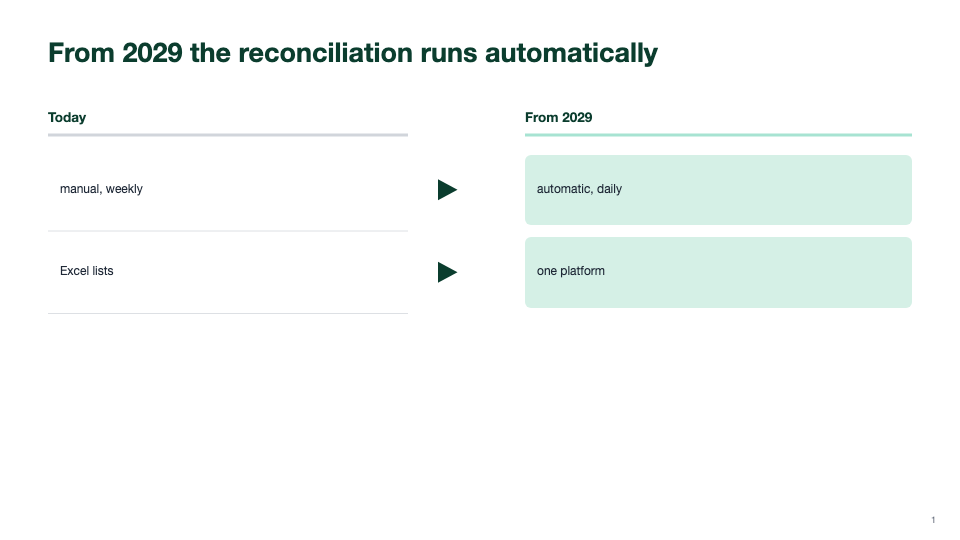
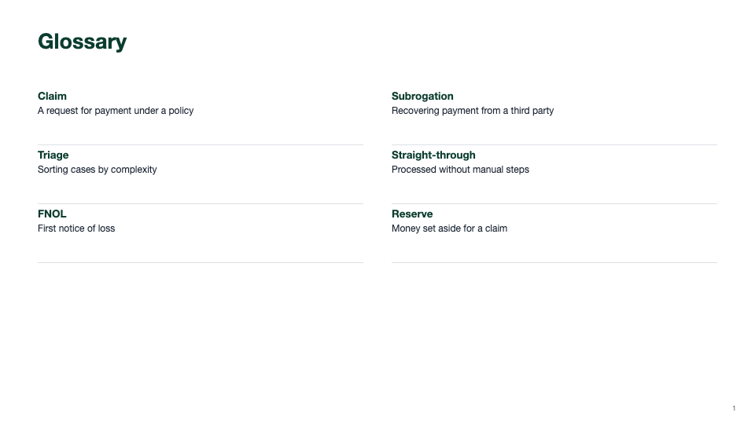
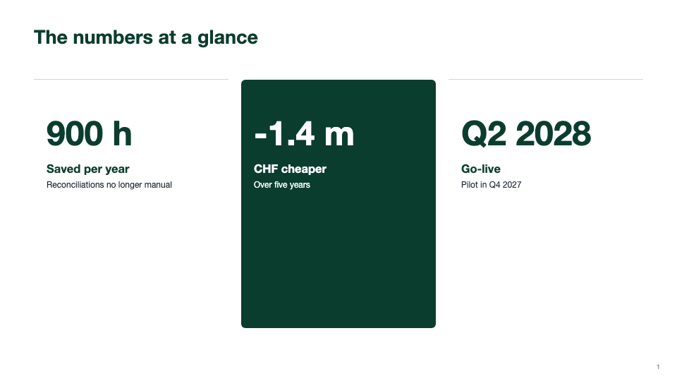
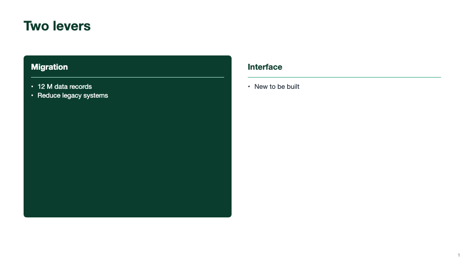
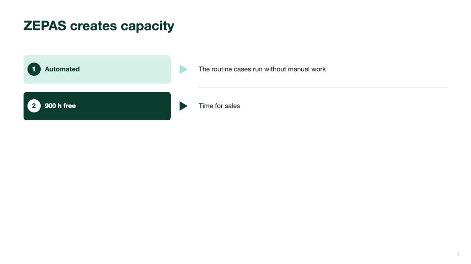
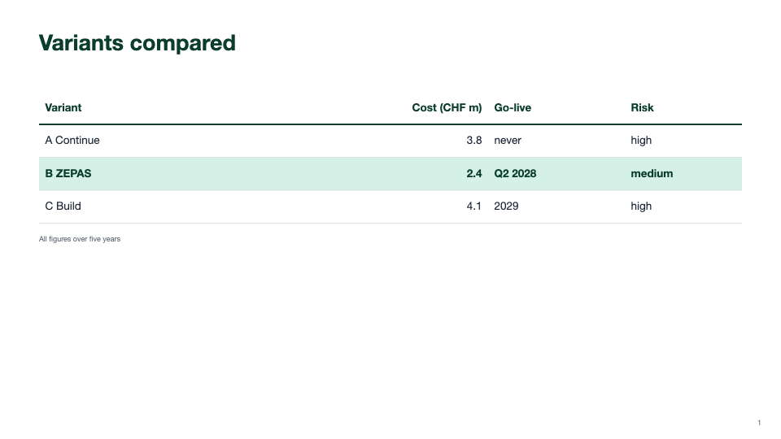
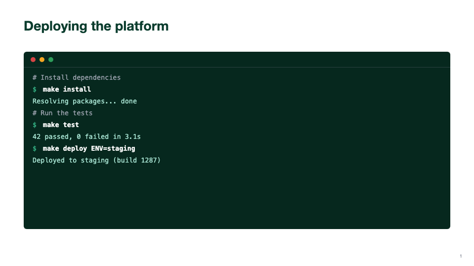

# body

[← All families](README.md)

Text, table, key-figure and terminal slides.

| slide | preview & description | parameters |
|---|---|---|
| `fromto` |  Use this slide to compare a current state with a future state side by side. Each row has one aligned item. | `title` (str, required): Slide headline. `left` (Side, required): Starting-state side. `left.head` (str, required): Heading of this side. `left.items` (list[str], optional, default: []): Bullet items. Both sides need the same number of items, from 1 to 6. `left.icon` (str | None, optional): Optional icon name. `right` (Side, required): Target-state side. `right.head` (str, required): Heading of this side. `right.items` (list[str], optional, default: []): Bullet items. Both sides need the same number of items, from 1 to 6. `right.icon` (str | None, optional): Optional icon name. |
| `glossary` |  Use this slide to define terms or acronyms. The slide shows two columns of term and definition pairs. | `title` (str, required): Slide headline. `terms` (list[Term], required): Terms, between 1 and 12. `terms[].term` (str, required): Term to define. `terms[].definition` (str, required): Definition of the term. |
| `keyfigures` |  Use this slide for hero numbers: a grid of tiles with a figure and a label. Each tile can have a caption, and you can highlight one tile. | `title` (str, required): Slide headline. `tiles` (list[Tile], required): Figure tiles, between 2 and 6. `tiles[].figure` (str, required): Headline figure. `tiles[].label` (str, required): Caption under the figure. `tiles[].caption` (str | None, optional): Optional supporting caption. `highlight` (int | None, optional): 0-based index of the tile to emphasise. |
| `panels` |  Use this slide for 2 to 4 parallel themes or workstreams. Each panel has a heading, a bullet list, and an optional icon. Use style icons for 2 to 8 parallel concepts, each with an icon, a heading and a short text. | `title` (str, required): Slide headline. `panels` (list[Panel], required): Panels. The columns style takes 1 to 4. The icons style takes 2 to 8. `panels[].head` (str, required): Panel heading. `panels[].items` (list[str], optional, default: []): Bullet items in the panel. `panels[].icon` (str | None, optional): Optional icon name. `panels[].text` (str | None, optional): Optional supporting text. The icons style shows it, not items. `highlight` (int | None, optional): 0-based index of the panel to emphasise. Columns style only. `style` (Literal["columns", "icons"], optional, default: "columns"): 'columns' for panels with bullet lists, or 'icons' for a grid of icon, heading and text. `banner` (str | None, optional): Optional banner text across the bottom. Icons style only. |
| `rows` |  Use this slide for a short numbered list of points. Each point has a label and an explanation. You can also add a conclusion at the end. | `title` (str, required): Slide headline. `rows` (list[Row], required): Rows, between 1 and 6. `rows[].label` (str, required): Row heading. `rows[].text` (str | None, optional): Row body text. `rows[].icon` (str | None, optional): Optional icon name. `highlight` (int | None, optional): 0-based index of the row to emphasise. `conclusion` (str | None, optional): Optional closing banner, executive-summary style. |
| `table` |  Use this slide for tabular data with a header row. You can highlight a column or a row, align each column and add a note. | `title` (str, required): Slide headline. `header` (list[str], required): Column headers. `rows` (list[list[str]], required): Table rows, each with one cell per header. Use between 1 and 16 rows. `align` (list[Literal["left", "center", "right"]] | None, optional): Per-column alignment. The default is numbers right and text left. `highlight_row` (int | None, optional): 0-based row index to emphasise. `highlight_col` (int | None, optional): 0-based column index to emphasise. `note` (str | None, optional): Optional footnote. |
| `terminal` |  Use this slide to show commands, comments and output in a terminal window. An example is an installation or CLI walkthrough. | `title` (str, required): Slide headline. `lines` (list[TermLine], required): Terminal lines, between 1 and 14. `lines[].text` (str, required): Line text. `lines[].kind` (Literal["command", "output", "comment"], optional, default: "output"): Line style: command, output, or comment. |
