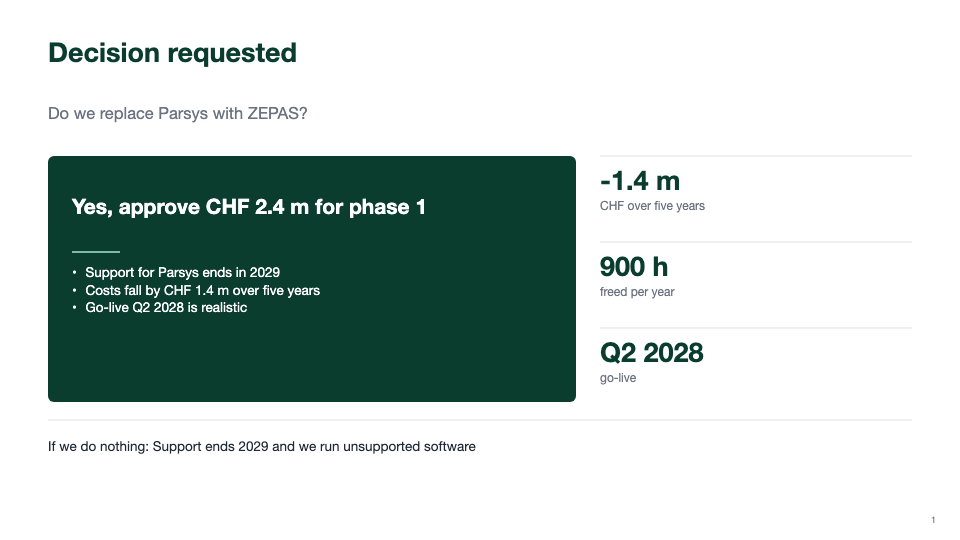
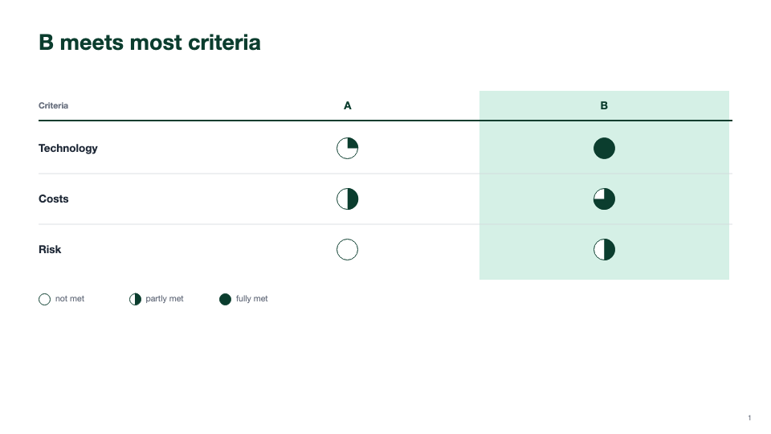
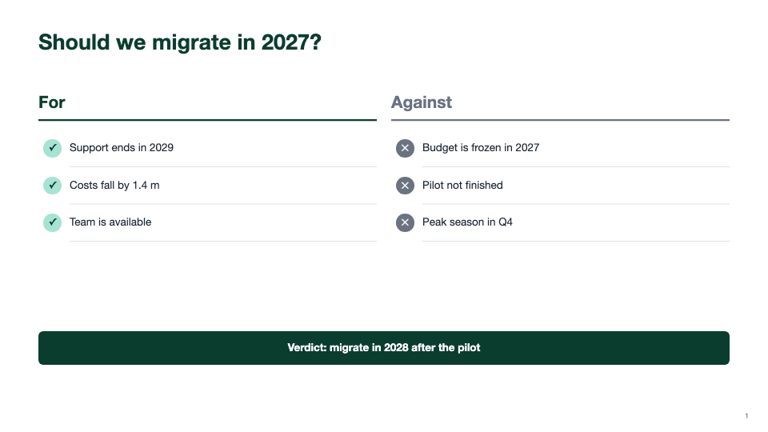
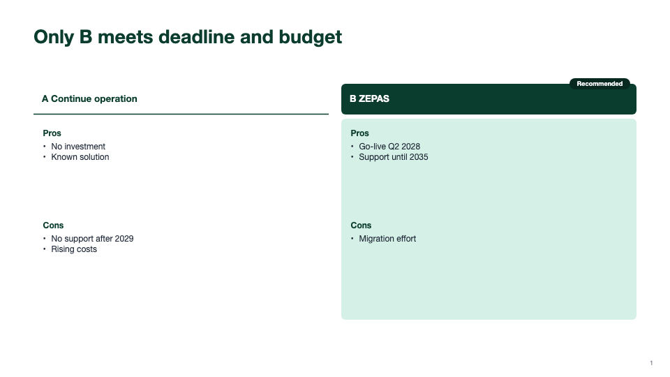
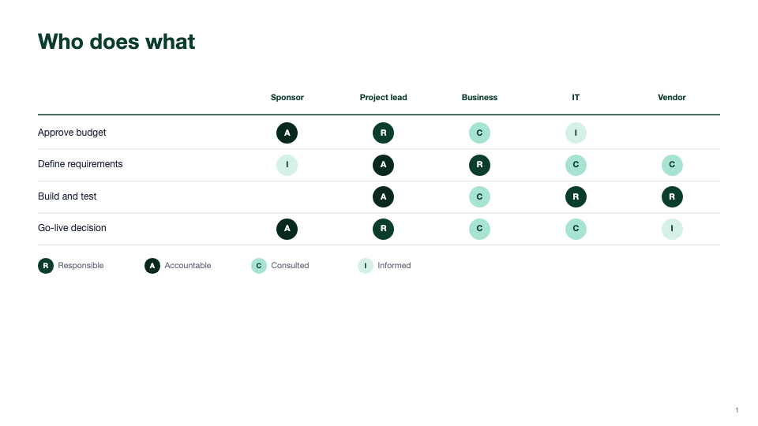
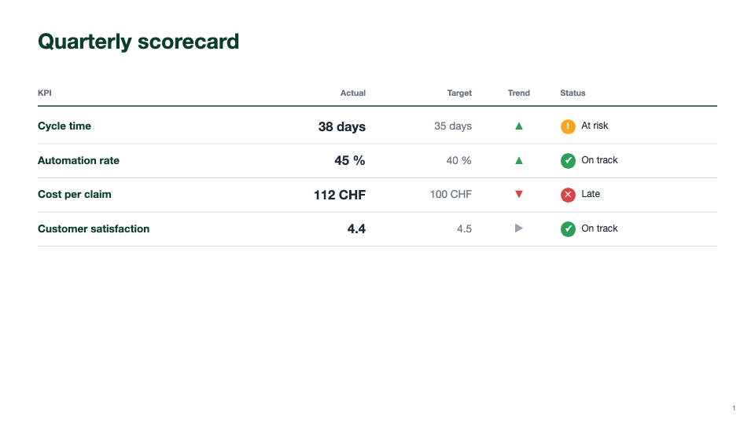
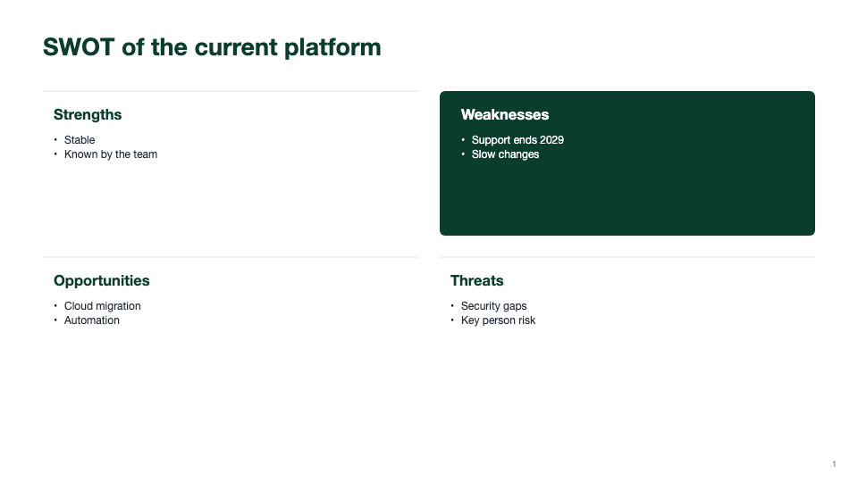

# decisions

[← All families](README.md)

Options, assessments and decisions.

| slide | preview & description | parameters |
|---|---|---|
| `decision` |  Use this slide to state a recommendation with its question and reasons. You can add figures and the cost of no action. | `title` (str, required): Slide headline. `question` (str, required): The decision question. `recommendation` (str, required): Recommended course of action. `reasons` (list[str], optional, default: []): Reasons supporting the recommendation. `figures` (list[Figure], optional, default: []): Supporting figures, at most 3. `figures[].figure` (str, required): Large figure value. `figures[].label` (str, required): Caption under the figure. `otherwise` (str | None, optional): Consequence of taking no action. |
| `evaluation` |  Use this slide to score options against criteria with 0 to 4 score balls. You can also mark a recommended option and add a legend. | `title` (str, required): Slide headline. `criteria` (list[str], required): Evaluation criteria. Each criterion is one matrix row. `options` (list[str], required): Options to compare. Each option is one matrix column. `scores` (list[list[Cell]], required): Rating matrix indexed as scores[criterion][option]. Each cell is a Harvey-ball score or an object with a score and a note. `scores[][].score` (int, required): Harvey-ball fill from 0 (empty) to 4 (full). `scores[][].note` (str | None, optional): Optional note shown under the rating. `recommended` (int | None, optional): 0-based index of the recommended option. The slide shades its column. `key` (str | None, optional): Legend text for the rating scale. It replaces the default. |
| `forandagainst` |  Use this slide to weigh arguments for and against a proposal. You can also add a verdict banner at the end. | `title` (str, required): Slide headline. `for` (list[str], required): Arguments in favour. `against` (list[str], required): Arguments against. `for_label` (str, optional, default: "For"): Heading for the 'for' column, e.g. 'Do' or 'Pros'. `against_label` (str, optional, default: "Against"): Heading for the 'against' column, e.g. 'Don't' or 'Cons'. `verdict` (str | None, optional): Optional conclusion line. |
| `options` |  Use this slide to compare 2 to 4 options directly. Each option has pros and cons. You can also mark one option as recommended. | `title` (str, required): Slide headline. `options` (list[Option], required): Options to compare, between 2 and 4. `options[].name` (str, required): Option name. `options[].pros` (list[str], optional, default: []): Advantages of the option. `options[].cons` (list[str], optional, default: []): Drawbacks of the option. `options[].icon` (str | None, optional): Optional icon name. `recommended` (int | None, optional): 0-based index of the recommended option. |
| `raci` |  Use this slide to assign Responsible, Accountable, Consulted and Informed roles to activities. The columns are roles or people. | `title` (str, required): Slide headline. `roles` (list[str], required): Role names, between 2 and 8. `activities` (list[Activity], required): Activities, between 1 and 12. `activities[].name` (str, required): Activity name. `activities[].assignments` (list[str], required): One R/A/C/I assignment per role. Use a blank string for no assignment. |
| `scorecard` |  Use this slide for a KPI scorecard. Each row shows the actual value, the target, the trend direction and a traffic-light status. | `title` (str, required): Slide headline. `kpis` (list[Kpi], required): KPIs, between 1 and 10. `kpis[].name` (str, required): KPI name. `kpis[].actual` (str, required): Current value. `kpis[].target` (str | None, optional): Target value. `kpis[].trend` (Literal["up", "flat", "down"] | None, optional): Trend direction indicator. `kpis[].state` (str | None, optional): Optional status label, e.g. 'On track'. `kpis[].unit` (str | None, optional): Unit suffix for the values. |
| `swot` |  Use this slide for a SWOT analysis with strengths, weaknesses, opportunities and threats. You can highlight one quadrant. | `title` (str, required): Slide headline. `strengths` (list[str], optional, default: []): Strengths (internal, positive). `weaknesses` (list[str], optional, default: []): Weaknesses (internal, negative). `opportunities` (list[str], optional, default: []): Opportunities (external, positive). `threats` (list[str], optional, default: []): Threats (external, negative). `highlight` (Literal["strengths", "weaknesses", "opportunities", "threats"] | None, optional): Quadrant to emphasise. |
