# diagram

[← All families](README.md)

Process and concept diagrams.

| slide | preview & description | parameters |
|---|---|---|
| `cycle` | <a href="images/diagram/cycle.png">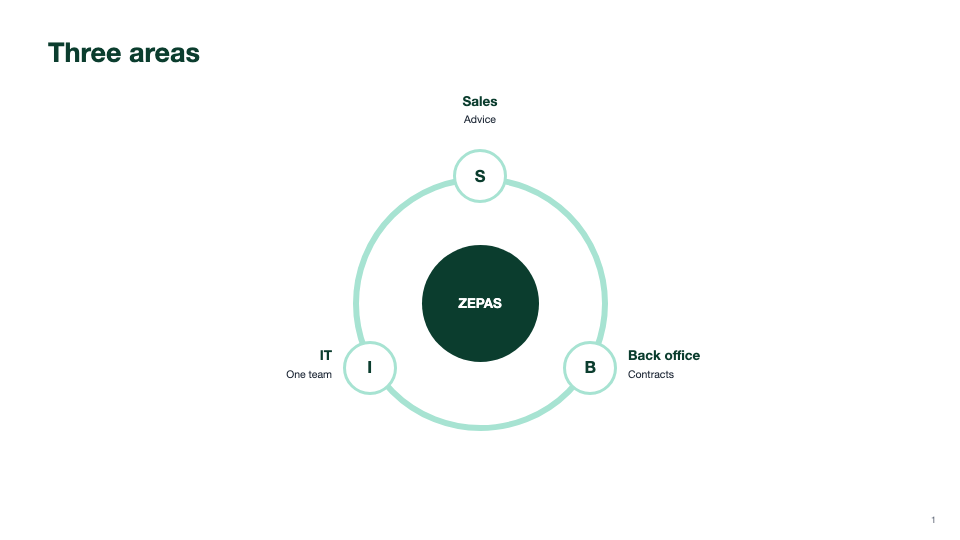</a> Use this slide for a repeating or circular process with 3 to 6 stages. You can highlight one stage. | `title` (str, required): Slide headline. `centre` (str, required): Text in the centre of the cycle. `items` (list[CycleItem], required): Cycle steps, between 3 and 6. `items[].label` (str, required): Step label. `items[].text` (str | None, optional): Supporting text for the step. `items[].icon` (str | None, optional): Optional icon name. `highlight` (int | None, optional): 0-based index of the step to emphasise. |
| `drivertree` | <a href="images/diagram/drivertree.png">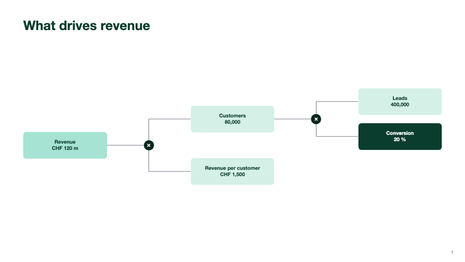</a> Use this slide to divide a root metric into sub-drivers and leaves. You can also show the operation that combines each branch. | `title` (str, required): Slide headline. `root` (DriverNode, required): Root node of the driver tree. `root.label` (str, required): Node label. `root.value` (str | None, optional): Value shown at the node. `root.op` (Literal["×", "+", "-", "x", "*"] | None, optional): Operator combining the children into this node. `root.children` (list[DriverNode], optional, default: []): Child nodes. The list is empty for a leaf. `highlight` (str | None, optional): Label of the node to emphasise. |
| `fishbone` | <a href="images/diagram/fishbone.png">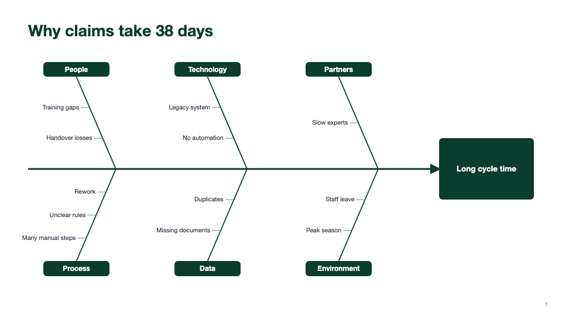</a> Use this slide for root-cause analysis. The slide shows an effect at the head and cause categories as bones along a spine. | `title` (str, required): Slide headline. `effect` (str, required): The effect or problem to analyse. `categories` (list[Category], required): Cause categories, between 3 and 6. `categories[].label` (str, required): Cause category label. `categories[].causes` (list[str], optional, default: []): Causes in this category, at most 5. |
| `funnel` | <a href="images/diagram/funnel.png">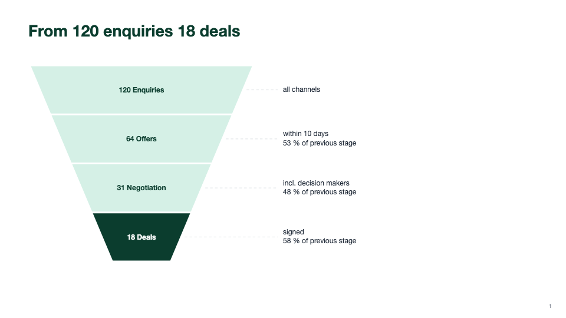</a> Use this slide to show a progressive narrowing through 2 to 6 stages. Each stage can have a note and a conversion value from the previous stage. | `title` (str, required): Slide headline. `stages` (list[Stage], required): Funnel stages, between 2 and 6, widest first. `stages[].label` (str, required): Stage label. `stages[].value` (str | None, optional): Value shown for the stage. `stages[].text` (str | None, optional): Supporting text for the stage. `highlight` (int | None, optional): 0-based index of the stage to emphasise. The default is the last stage. |
| `layers` | <a href="images/diagram/layers.png">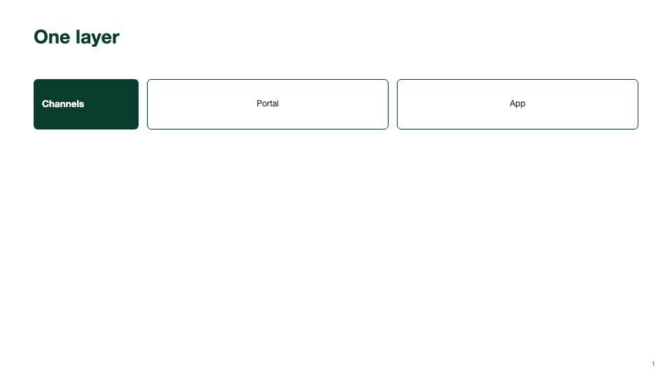</a> Use this slide to show a stack of layers. Each layer has a name and contains one or more elements. You can highlight layers. | `title` (str, required): Slide headline. `layers` (list[Layer], required): Layers, between 1 and 7, top layer first. `layers[].name` (str, required): Layer name. `layers[].elements` (list[str], optional, default: []): Elements contained in the layer. `highlight` (int | list[int] | None, optional): 0-based layer index, or list of indices, to emphasise. |
| `matrix` | <a href="images/diagram/matrix.png">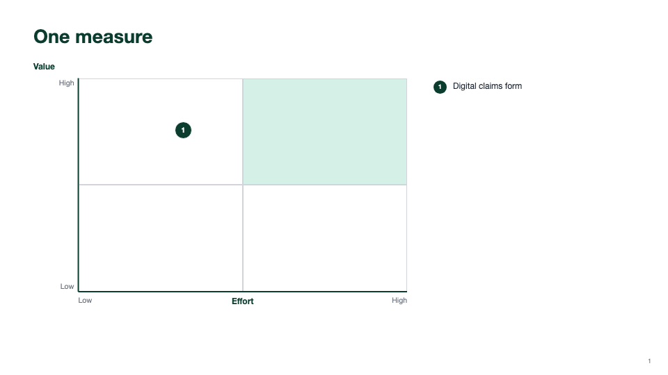</a> Use this slide to position items in a 2x2 matrix with named axes. You can add quadrant labels and a numbered legend. | `title` (str, required): Slide headline. `x_axis` (MatrixAxis, required): Horizontal axis configuration. `x_axis.low` (str | None, optional): Low-end axis label. `x_axis.high` (str | None, optional): High-end axis label. `x_axis.name` (str | None, optional): Axis name. `y_axis` (MatrixAxis, required): Vertical axis configuration. `y_axis.low` (str | None, optional): Low-end axis label. `y_axis.high` (str | None, optional): High-end axis label. `y_axis.name` (str | None, optional): Axis name. `items` (list[MatrixItem], required): Items to plot, between 1 and 12. `items[].label` (str, required): Item label. `items[].x` (float, required): Horizontal position. `items[].y` (float, required): Vertical position. `quadrants` (list[str] | None, optional): Optional quadrant labels in order [top-left, top-right, bottom-left, bottom-right]. `highlight` (int | None, optional): 0-based index of the item to emphasise. `scale` (tuple[float, float], optional, default: [0, 10]): (min, max) value range shared by the x and y axes. |
| `org` | <a href="images/diagram/org.png">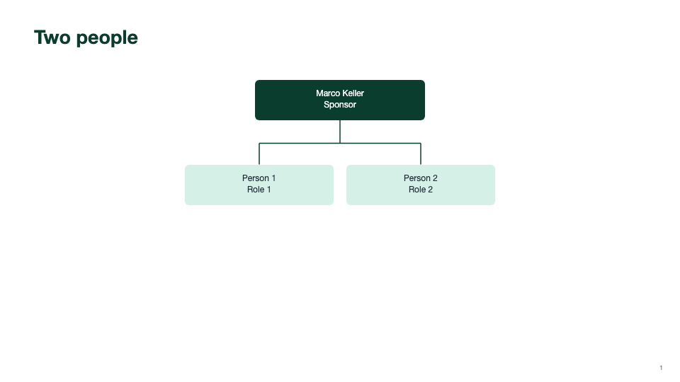</a> Use this slide for an organisation or team hierarchy. The slide shows one head, optional groups, and the people in each group. | `title` (str, required): Slide headline. `head` (Person, required): Person at the top of the organisation. `head.name` (str, required): Person's name. `head.role` (str | None, optional): Role or title. `members` (list[Person], optional, default: []): Direct reports of the head. `members[].name` (str, required): Person's name. `members[].role` (str | None, optional): Role or title. `groups` (list[OrgGroup], optional, default: []): Grouped reports. The members or groups must not be empty. `groups[].label` (str, required): Group name. `groups[].members` (list[Person], optional, default: []): People in the group. `groups[].members[].name` (str, required): Person's name. `groups[].members[].role` (str | None, optional): Role or title. |
| `pillars` | <a href="images/diagram/pillars.png">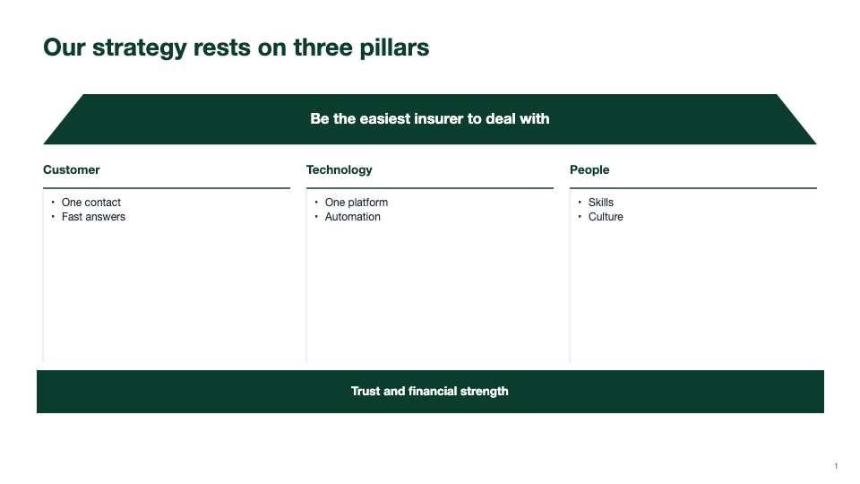</a> Use this slide for a strategy house: an overarching roof on pillars. You can also add a foundation below the pillars. | `title` (str, required): Slide headline. `roof` (str, required): Text on the roof of the structure. `pillars` (list[Pillar], required): Pillars, between 3 and 5. `pillars[].head` (str, required): Pillar heading. `pillars[].items` (list[str], optional, default: []): Items supporting the pillar. `foundation` (str | None, optional): Optional foundation text. |
| `process` | <a href="images/diagram/process.png">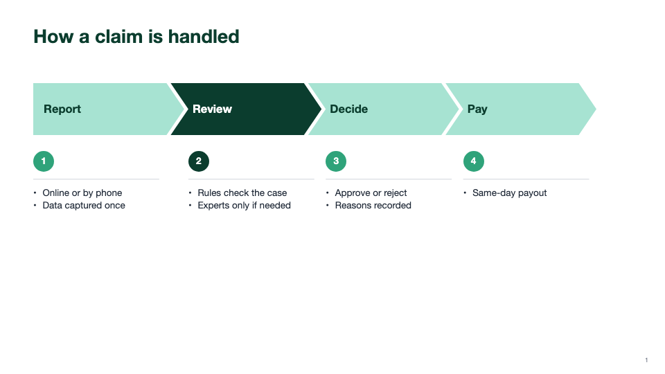</a> Use this slide for a sequence of 3 to 6 process steps or project phases. Each step has a heading, an icon, an optional period and optional detail bullets. You can highlight one step, for example the current phase. | `title` (str, required): Slide headline. `steps` (list[ProcessStep], required): Process steps, between 3 and 6. `steps[].head` (str, required): Step heading. `steps[].items` (list[str], optional, default: []): Supporting details for the step. `steps[].icon` (str | None, optional): Optional icon name. `steps[].period` (str | None, optional): Optional period or date label shown under the heading. `highlight` (int | None, optional): 0-based index of the step to emphasise. |
| `pyramid` | <a href="images/diagram/pyramid.png">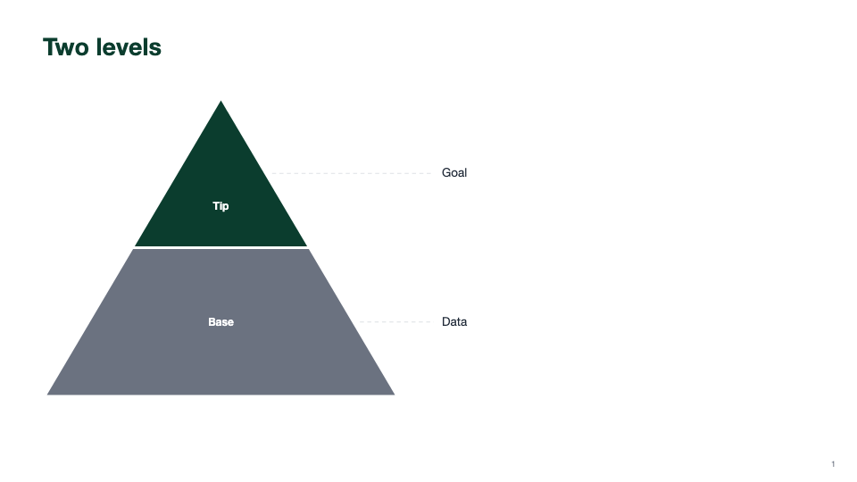</a> Use this slide for ranked or hierarchical levels, widest at the base. Each level has an explanatory note. Use style rings for layers from a core outward, such as priority rings. | `title` (str, required): Slide headline. `levels` (list[Level], required): Levels, between 2 and 6. A pyramid lists the top first. Rings list the core first, between 3 and 5. `levels[].label` (str, required): Level name. `levels[].text` (str | None, optional): Supporting text for the level. `style` (Literal["pyramid", "rings"], optional, default: "pyramid"): 'pyramid' for stacked levels, or 'rings' for concentric rings around a core. `highlight` (int | None, optional): 0-based index of the ring to emphasise. Only for style rings. |
| `swimlanes` | <a href="images/diagram/swimlanes.png">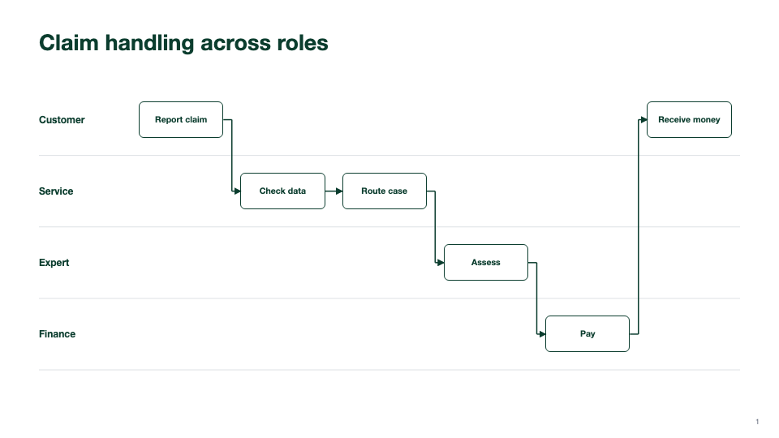</a> Use this slide for cross-functional processes with lanes and numbered columns. The slide shows step boxes and labelled flow links. | `title` (str, required): Slide headline. `lanes` (list[str], required): Lane names, between 2 and 5. `steps` (list[LaneStep], required): Steps, between 2 and 14. `steps[].lane` (str, required): Name of the lane that contains the step. The value must match one of lanes. `steps[].label` (str, required): Step label. `steps[].col` (int, required): 0-based column position, 0-7. `links` (list[Link], optional, default: []): Optional links between step indices. `links[].from` (int, required): 0-based index of the source step. `links[].to` (int, required): 0-based index of the target step. |
| `venn` | <a href="images/diagram/venn.png">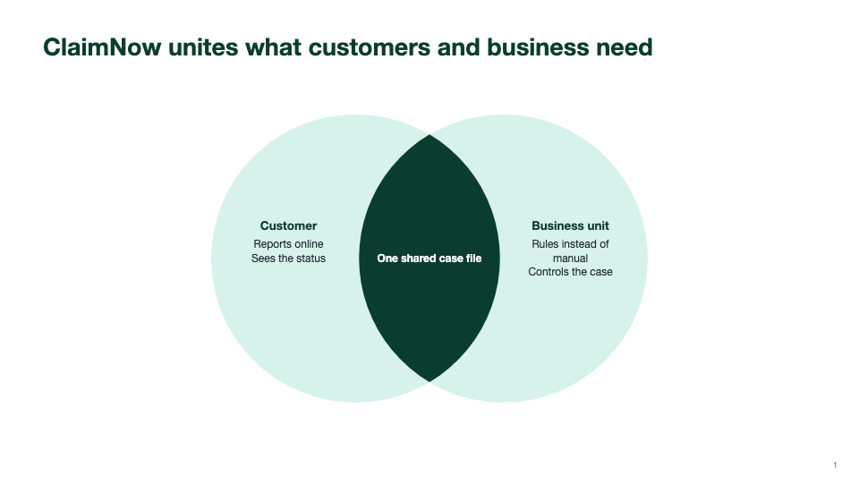</a> Use this slide to show the overlap between two or three sets. Each circle has an item list, and the overlap has a shared label. | `title` (str, required): Slide headline. `circles` (list[Circle], required): Circles, between 2 and 3. `circles[].label` (str, required): Circle label. `circles[].items` (list[str], optional, default: []): Items belonging to this circle. `overlap` (str, required): Text for the shared overlap region. |
