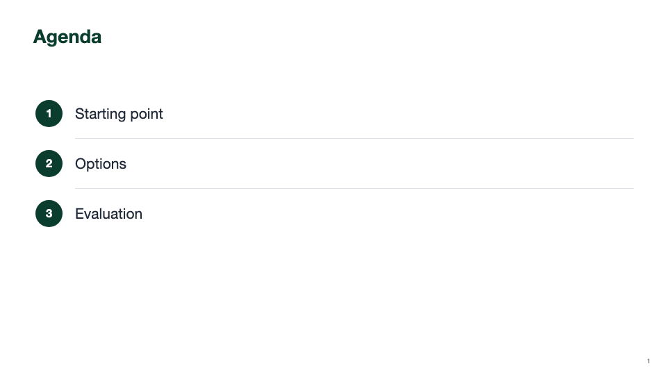
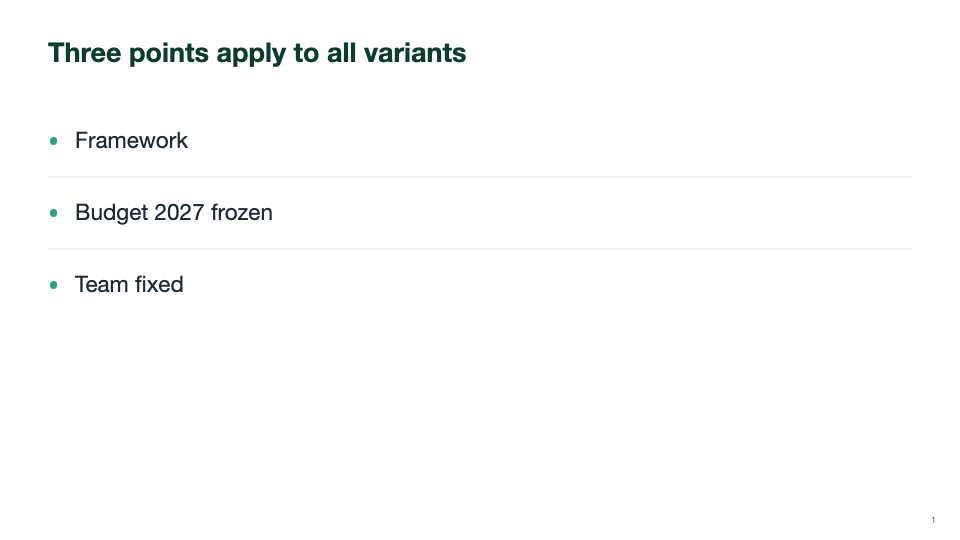
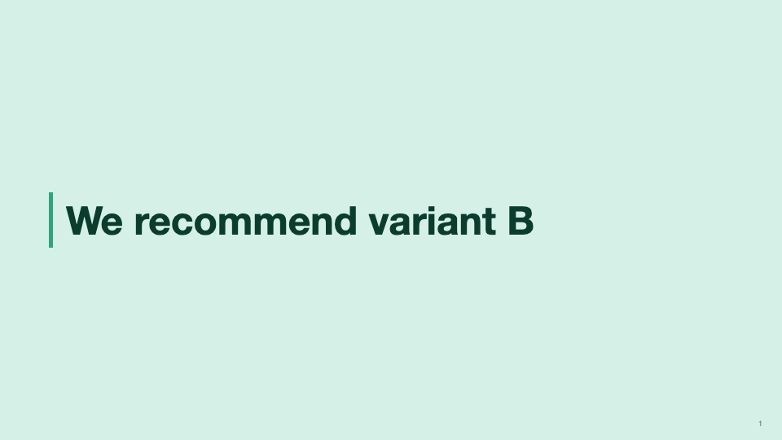
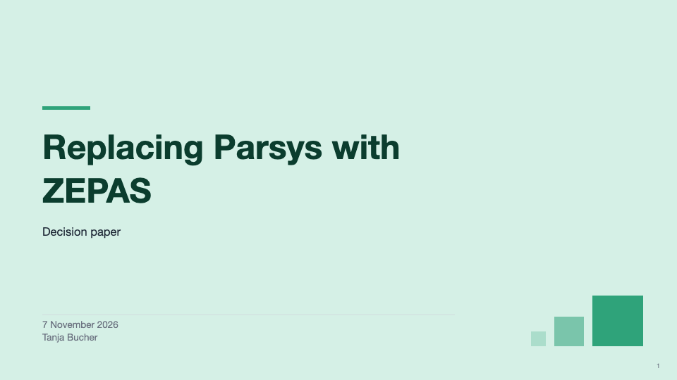

# layout

[← All families](README.md)

Opening, divider, agenda, text and closing slides.

| slide | preview & description | parameters |
|---|---|---|
| `agenda` |  Use this slide for an agenda or chapter list. The items are numbered or have icons. Give items a time or owner for a timed agenda table. You can mark the current item. | `title` (str, optional, default: "Agenda"): Slide title. `lead` (list[str] | None, optional): Optional lead-in text. Use a string or a list of lines. `current` (int | None, optional): 0-based index of the current entry. A plain agenda dims the others. `items` (list[AgendaItem], required): Agenda entries, between 1 and 10. `items[].text` (str, required): Agenda entry text. `items[].icon` (str | None, optional): Optional icon name. `items[].time` (str | None, optional): Optional time slot. Any item with a time or owner makes a timed agenda table. `items[].owner` (str | None, optional): Optional owner or speaker. |
| `chapter` |  Use this slide as a section divider. It shows a large chapter number and title on a primary-coloured background. | `title` (str, required): Chapter title. `number` (list[str], required): Chapter number. The value 2 renders as '02'. The slide joins a list with spaces. |
| `contact` |  Use this slide to close a deck with contact details. Each person has a role, an email address and a phone number. Give people a photo or a short text to introduce a team of up to 8 as a grid. | `title` (str, optional, default: "Contact"): Slide title. `people` (list[Person], required): People, between 1 and 8. Contact cards take up to 6. Any person with a photo or a text makes a team grid instead. `people[].name` (str, required): Person's name. `people[].role` (str | None, optional): Role or title. `people[].mail` (str | None, optional): Email address. `people[].phone` (str | None, optional): Phone number. `people[].text` (str | None, optional): Short bio or note. Makes a team grid. `people[].photo` (str | None, optional): Optional image file path or URL. Makes a team grid. |
| `content` |  Use this slide for general text. It has body lines or bullets. You can add a lead paragraph and a callout box. | `title` (str, required): Slide headline. `body` (list[str], required): Body text. Use a string or a list of lines. `lead` (list[str] | None, optional): Optional lead-in text. Use a string or a list of lines. `small` (bool, optional, default: false): Use smaller body text to fit more content. `box` (list[str] | None, optional): Optional highlighted 'one thing to remember' box on the right. |
| `statement` |  Use this slide to emphasise one large statement, a big number or a quotation. You can add a figure with a label, up to 3 supporting points, an author for a quotation, and a background image. | `title` (str, required): Slide headline. `lead` (list[str] | None, optional): Optional lead-in text. Use a string or a list of lines. `points` (list[str], optional, default: []): Up to 3 supporting points. `figure` (list[str] | None, optional): Optional large figure. `label` (list[str] | None, optional): Optional label for the figure. `author` (str | None, optional): Optional attribution. Use it when the title is a quotation. `image` (str | None, optional): Optional background image path or URL, darkened under the text. |
| `title` |  Use this slide to open a deck with its title. You can add a subtitle, metadata and a side image. | `title` (str, required): Slide headline. `subtitle` (list[str] | None, optional): Optional subtitle lines. `meta` (list[str] | None, optional): Optional metadata lines, e.g. date or author. `image` (str | None, optional): Optional image path or URL shown on the right half. |
