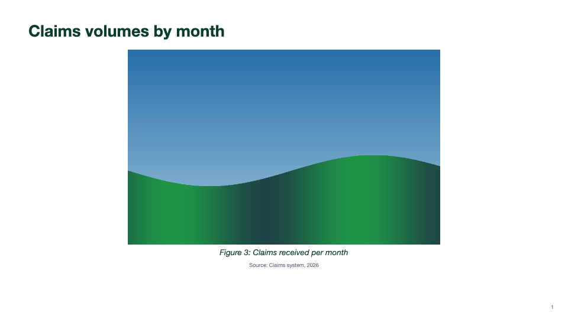
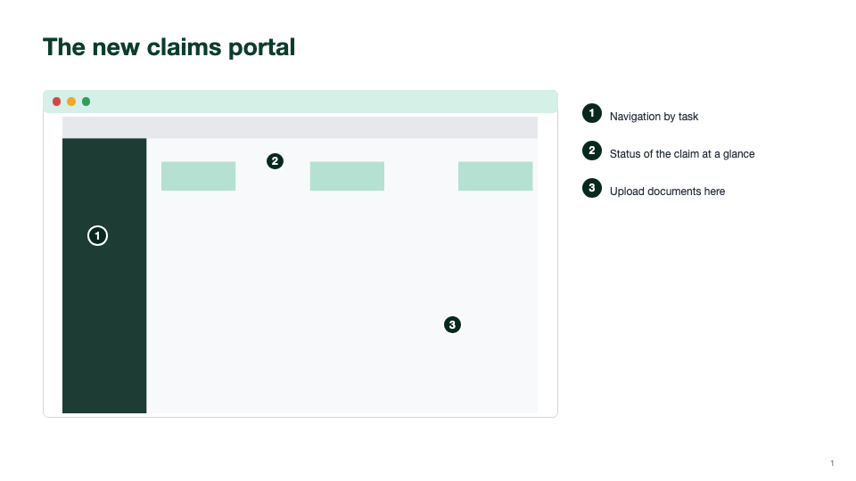

# pictures

[← All families](README.md)

Slides built around a picture.

| slide | preview & description | parameters |
|---|---|---|
| `figure` |  Use this slide to present one picture across the full width, with a caption and a source. The picture carries its own labels and notes: the slide has no side text. Set bleed for a full-bleed photograph with the title in a dark band. | `title` (str, required): Slide headline. `image` (str, required): Image file path or URL. A missing file renders a labelled placeholder. `caption` (str | None, optional): Figure caption. `source` (str | None, optional): Optional source line. `bleed` (bool, optional, default: false): If true, the picture fills the whole slide and the title sits in a dark band at the bottom, with the caption below it. The source is not shown. |
| `screenshot` |  Use this slide to present a screenshot in a browser frame. Numbered callouts explain each point. | `title` (str, required): Slide headline. `image` (str, required): Image file path or URL. A missing file renders a labelled placeholder. `callouts` (list[Callout], optional, default: []): Callouts, at most 8. `callouts[].x` (float, required): Horizontal position inside the picture, 0 (left) to 1 (right). `callouts[].y` (float, required): Vertical position inside the picture, 0 (top) to 1 (bottom). `callouts[].text` (str, required): Callout text. |
