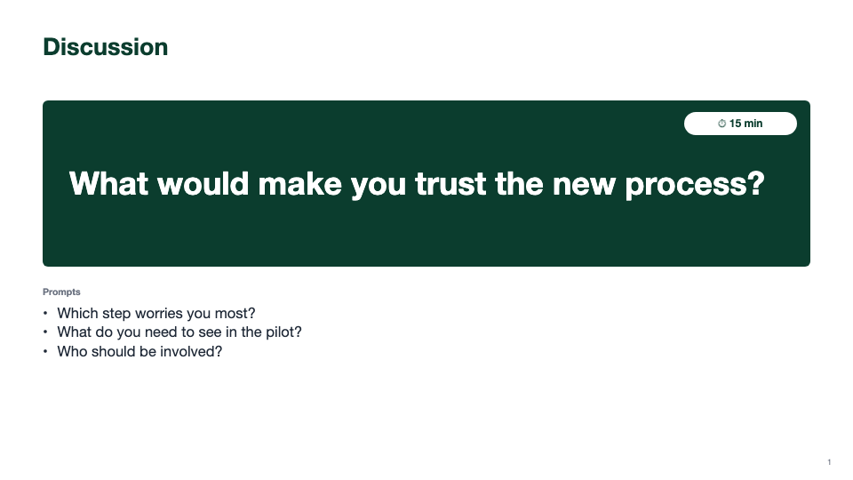
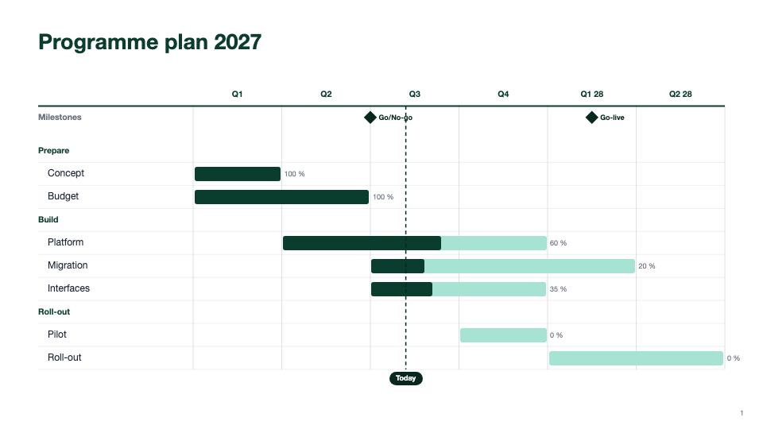
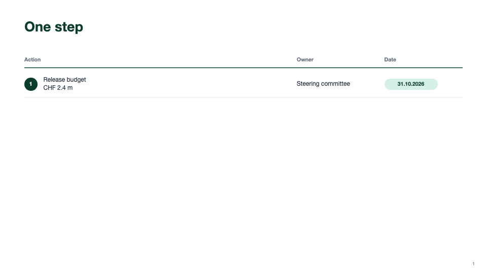
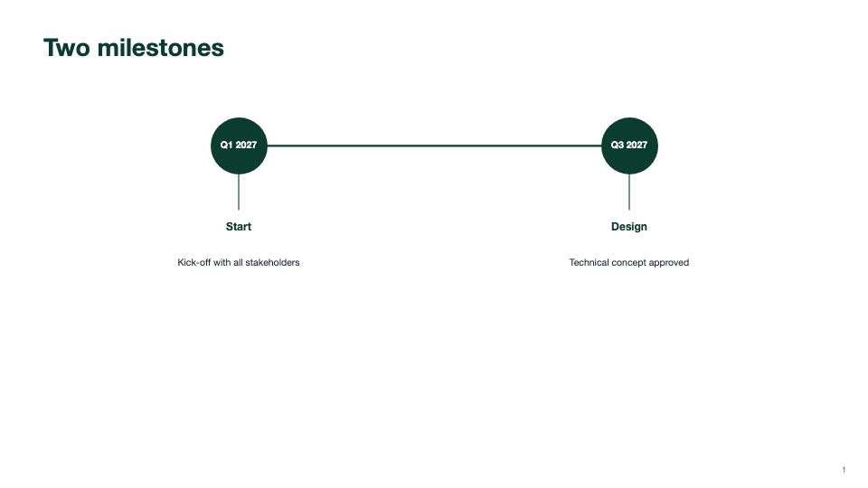
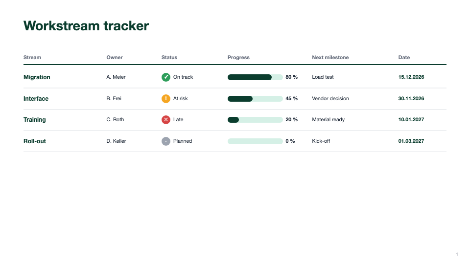

# programme

[← All families](README.md)

Plans, timelines and project status.

| slide | preview & description | parameters |
|---|---|---|
| `discussion` |  Use this slide to focus a workshop or meeting discussion on one question. You can add prompts and a timebox. | `title` (str, required): Slide headline. `question` (str, required): Discussion question. `prompts` (list[str], optional, default: []): Optional discussion prompts. `timebox` (str | None, optional): Optional timebox, e.g. '15 min'. |
| `gantt` |  Use this slide for a project plan over time with grouped rows and bars that span periods. You can add progress percentages, milestones and a today marker. | `title` (str, required): Slide headline. `periods` (list[str], required): Period labels, between 2 and 24. `rows` (list[GanttRow], required): Gantt rows, between 1 and 14. `rows[].name` (str, required): Row name. `rows[].start` (float, required): 0-based index of the first period. `rows[].end` (float, required): 0-based index of the last period, inclusive. The bar covers start through end + 1. `rows[].group` (str | None, optional): Optional group label. `rows[].progress` (float | None, optional): Optional completion percentage, 0-100. `milestones` (list[GanttMilestone], optional, default: []): Optional milestones. `milestones[].label` (str, required): GanttMilestone label. `milestones[].at` (float, required): Position in periods. The value 0 is the start of the first period. `today` (float | None, optional): Optional 'today' position in periods. |
| `steps` |  Use this slide for a list of actions, next steps or a checklist with owner and date columns. Mark finished steps as done. You can add a call to action at the end. | `title` (str, required): Slide headline. `steps` (list[Step], required): Steps, between 1 and 8. `steps[].head` (str, required): Step heading. `steps[].text` (str | None, optional): Supporting text for the step. `steps[].owner` (str | None, optional): Responsible owner. `steps[].date` (str | None, optional): Target date. `steps[].done` (bool, optional, default: false): Whether the step is complete. `ask` (str | None, optional): Optional 'ask' callout. |
| `timeline` |  Use this slide for dated milestones in order. You can also mark the current milestone and add detail cards below the milestones. | `title` (str, required): Slide headline. `milestones` (list[Milestone], required): Milestones in order, between 2 and 10. `milestones[].date` (str, required): Date or period label for the milestone. `milestones[].label` (str | None, optional): Milestone heading. `milestones[].detail` (str | None, optional): Supporting detail text. `milestones[].icon` (str | None, optional): Optional icon name. `today` (int | None, optional): 0-based index of the milestone that represents 'now'. |
| `tracker` |  Use this slide to track workstreams. Each row shows the owner, a traffic-light status, the progress percentage and the next milestone date. | `title` (str, required): Slide headline. `rows` (list[TrackerRow], required): Tracker rows, between 1 and 10. `rows[].stream` (str, required): Workstream name. `rows[].owner` (str | None, optional): Owner. `rows[].state` (str, required): Current state label. `rows[].percent` (float | None, optional): Completion percentage, 0-100. `rows[].next` (str | None, optional): Next step. `rows[].date` (str | None, optional): Next-step date. |
